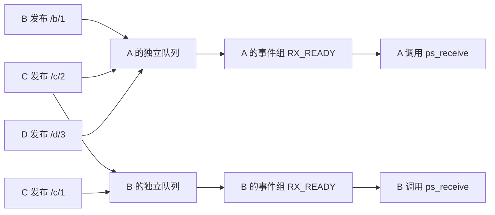

# FreeRTOS 子主题发布/订阅框架

参考 ROS 的 topic 通信模型，用 **消息队列 + 事件 + 互斥锁** 实现任务间发布/订阅。核心模块通过独立的 port 接口调用操作系统组件，不依赖 FreeRTOS 头文件。默认提供 FreeRTOS / ESP-IDF 适配，主要面向后续移植到 ESP32；更换系统时替换 `port/pubsub_port.c`。

## 子主题模型

任务名称是命名空间，每个子主题是一个独立 topic：

| 任务 | 可发布的子主题 | 示例订阅 |
| --- | --- | --- |
| A | `/a/1`、`/a/2`、`/a/3` | `/b/1`、`/c/2`、`/d/3` |
| B | `/b/1`、`/b/2`、`/b/3` | `/c/1`、`/c/2` |
| C | `/c/1`、`/c/2`、`/c/3` | 无，可自行添加 |
| D | `/d/1`、`/d/2`、`/d/3` | 无，可自行添加 |

订阅 `/c/2` 只接收这个子主题，不接收 `/c/1`、`/c/3`。当前使用完整名称精确匹配，不支持通配符；订阅 C 的所有子主题时分别订阅三次即可。也可以使用更有业务含义的名称，例如 `/motor/speed`、`/motor/state`。



**不能让所有订阅者共用一个接收队列**：同一条队列消息只会被一个接收者取走。本框架为每个客户端创建独立队列，发布时向每个匹配客户端复制一份，所以 `/c/2` 可以同时被 A 和 B 收到。客户端通常对应一个任务；发布不要求创建客户端。

## 文件

- `include/pubsub.h`：用户调用 API、标准 C 类型与容量设置，不包含操作系统头文件。
- `src/pubsub.c`：系统无关的注册、路由、订阅、发布、接收与统计逻辑。
- `port/pubsub_port.h`：队列、事件、互斥锁与时钟的移植接口，不公开原生 OS 类型。
- `port/pubsub_port.c`：默认 FreeRTOS / ESP-IDF 实现，其他系统替换此文件。
- [port/README.md](port/README.md)：详细移植约定与构建边界。
- `examples/pubsub_demo.c/.h`：A/B/C/D 四任务，各发布三个子主题。
- `CMakeLists.txt`：ESP-IDF component 入口，默认编译核心模块与 FreeRTOS port。
- `tests/`：Windows 主机行为测试及 FreeRTOS API 模拟层，模拟层只用于测试。

## 基本用法

启动时先初始化、注册 topic、创建接收客户端并配置订阅；再启动发布/接收任务。`ps_init()` 应由单个启动任务调用，且早于任何并发框架调用；既可以在普通 FreeRTOS 启动调度器前调用，也可以在 ESP-IDF 的 `app_main()` 调用。

```c
#include <string.h>
#include "pubsub.h"

typedef struct {
    int32_t value;
    uint32_t sample_id;
} SensorData;

static PsClient *client_a;
static PsClient *client_b;
static PsTopic topic_c2;

static PsStatus communication_init(void)
{
    PsStatus status;
    status = ps_init();
    if (status != PS_OK) return status;
    status = ps_advertise("/c/2", sizeof(SensorData), &topic_c2);
    if (status != PS_OK) return status;
    status = ps_client_create(8, &client_a);
    if (status != PS_OK) return status;
    status = ps_client_create(8, &client_b);
    if (status != PS_OK) return status;
    status = ps_subscribe(client_a, "/c/2");
    if (status != PS_OK) return status;
    return ps_subscribe(client_b, "/c/2");
}

/* C 的任务里发布。payload 在函数返回后可以修改。 */
static PsStatus publish_c2(int32_t value, uint32_t sample_id)
{
    SensorData data = {value, sample_id};
    PsPublishReport report;
    PsStatus status = ps_publish(topic_c2, &data, sizeof(data), &report);
    /* report.matched / delivered / dropped：匹配、成功入队、队满丢弃数。
     * PS_PARTIAL 时已有订阅者可能收到消息，重发会造成重复。
     */
    return status;
}

/* A 的任务里接收；B 同样使用 client_b 接收。 */
static void task_a(void *argument)
{
    (void)argument;
    for (;;) {
        PsMessage message;
        if (ps_receive(client_a, &message, PS_WAIT_FOREVER) == PS_OK) {
            if (message.topic == topic_c2 && message.size == sizeof(SensorData)) {
                SensorData data;
                memcpy(&data, message.data, sizeof(data));
                /* 使用 data.value / data.sample_id 执行业务逻辑。 */
            }
        }
    }
}
```

任务 A 可以继续注册并发布 `/a/1` 等自己的子主题；发布与订阅互相独立。框架不限制某个 topic 的发布任务，也允许多个任务向同一 topic 发布。

### 接口行为

| 接口 | 含义 |
| --- | --- |
| `ps_advertise(name, size, &topic)` | 注册固定消息长度的 topic，返回数字 ID；同名同长度重复注册返回原 ID |
| `ps_topic_find(name, &topic)` | 按完整名称查找已有 topic |
| `ps_topic_name(topic)` | 获取稳定名称字符串，用于日志或分发 |
| `ps_client_create(depth, &client)` | 创建独立队列和事件组，depth 为所有订阅主题合计的消息容量 |
| `ps_subscribe(client, name)` | 订阅已注册的子主题；重复订阅不会重复投递 |
| `ps_unsubscribe(client, name)` | 停止后续入队；已入队消息仍可接收 |
| `ps_publish(topic, data, size, &report)` | 向所有订阅者复制消息，逐个报告队列满的情况 |
| `ps_receive(client, &message, timeout_ms)` | 从该客户端队列取下一条消息，返回 topic、数据长度、序号、发布毫秒时间和数据 |
| `ps_client_stats(client, &stats)` | 获取累计投递、丢弃、接收计数 |

接收超时单位统一为毫秒：`0` 为尝试一次，`100` 为等待约 100ms，`PS_WAIT_FOREVER` 为无限等待。用户 API 使用标准 C 类型，无须 `TickType_t`、`UBaseType_t` 或 `pdMS_TO_TICKS`。消息的 `timestamp_ms` 字段是发布时的 64 位单调毫秒时间，替代旧版原生 `tick` 字段。有限超时共用于内部互斥锁等待和事件等待，不会每次唤醒重新开始计时。

## 队列与事件如何配合

1. 发布者持有总线互斥锁，按订阅表向目标队列 `xQueueSend(..., 0)`。
2. 入队成功后，在同一把锁保护下设置客户端的 `RX_READY` 事件位。
3. 接收者持有同一把锁，尝试非阻塞出队。如果队列已经空了，清除事件位。
4. 没有消息时，接收者释放锁并等待事件。等待时不自动清位；被唤醒后再次检查队列。

队列保存每一条消息，事件位只表示“可能有消息”，不会用于统计消息数量。多条发布合并为一个事件位时，消息仍完整保存在队列里。

空队列检查与事件清除、入队与事件设置都使用同一把锁，避免“新消息刚到，却被接收者清掉唤醒标志”的竞态。若消息在释放锁与开始等待之间到达，事件位会保持置位，等待立即返回。每个客户端只安排一个任务调用接收接口。

## 内存与边界

默认容量：32 个 topic、8 个客户端、topic 名称缓冲区 32 字节（名称最多 31 字节）、消息数据最多 64 字节。四任务各三个主题需要 12 个 topic，足够使用。可以通过编译定义统一调整：

```text
PS_MAX_TOPICS=32
PS_MAX_CLIENTS=8
PS_TOPIC_NAME_SIZE=32
PS_MAX_PAYLOAD=64
```

订阅表使用 `uint32_t` 位图，当前最多 32 个 topic。事件组只使用一个低位，topic 数量不受 FreeRTOS 事件组可用位数影响。

每个客户端队列占用约 `queue_depth * sizeof(PsMessage)` 字节，另加操作系统队列/事件控制结构。消息包含 64 位毫秒时间戳，实际结构大小与编译器对齐规则有关。以目标编译器的 `sizeof` 为准。

内存分配发生在总线初始化和客户端创建时，发布/接收不申请堆内存。默认 port 使用 FreeRTOS 动态分配接口；需要 `configUSE_MUTEXES=1`、`configSUPPORT_DYNAMIC_ALLOCATION=1`、`INCLUDE_vTaskSuspend=1`。其他 OS 的分配方式由 port 实现决定。topics 和客户端具有应用生命周期，不提供运行中销毁/重置接口。

队列满时丢弃**该客户端的新消息**，保留旧消息和 FIFO 顺序，其他客户端继续接收。返回 `PS_PARTIAL`；没有订阅者时返回 `PS_OK`，报告 `matched=0`。每个 topic 的序号在有效发布时递增，包含没有订阅者的发布，因此只用于辅助识别顺序和间隔。序号和统计计数以 32 位无符号数回绕。

消息按字节复制，发送者和各接收者拥有独立副本。topic 检查固定字节长度，业务层应保证同名 topic 使用同一种数据结构。不要在 payload 中携带指向临时缓冲区的指针；复制指针不会复制所指向的数据。接收时通过 `memcpy` 还原结构体，避免直接强转字节数组带来的对齐问题。

订阅后只接收之后发布的消息，不保存历史，不提供可靠重传、持久化或 ROS 网络协议。一个客户端的多个主题共用其队列，高频主题会占用低频主题的容量；需要隔离时可以为同一任务创建多个客户端并自行安排非阻塞接收。

所有通信接口用于任务上下文，不用于 ISR。中断数据可以先送入专用 FreeRTOS 队列，由采集任务再发布。发布对队列空间不阻塞，但会等待内部互斥锁，复制成本与消息大小和订阅者数有关。

## 四任务示例

`examples/pubsub_demo.c` 注册全部 12 个 topic，建立表格中的订阅关系，并创建四个任务。每个任务约每秒发布自己的三个子主题，在剩余时间接收消息。即使持续有消息，发布周期也不会被不断延后。

接收回调在对应接收任务里执行，发布结果回调在发布任务里执行。回调指针参数只在该次调用期间有效。可以使用 topic ID 做 `switch` 分发不同业务处理。

普通 FreeRTOS 项目在启动调度器前调用 `ps_demo_start(on_message, on_publish)`，确认返回 `true` 后启动调度器。ESP-IDF 则从 `app_main()` 调用，调度器已经运行。示例通过启动事件屏障保证四个任务都创建成功后再开始发布，配置 `INCLUDE_vTaskDelete=1` 以支持创建失败时删除已创建的任务。失败后修正启动原因并重启，不重复创建。示例里的任务创建属于应用层；移植到其他 OS 时按目标系统调整示例，核心 port 不需要创建线程。

## 后续接入 ESP32 / ESP-IDF

核心模块可作为 component：把目录放入 `components/pubsub`，或者在应用顶层 `project(...)` 之前设置 `EXTRA_COMPONENT_DIRS` 指向本目录。提供的 component CMake 默认编译 `src/pubsub.c` 与 `port/pubsub_port.c`；`port` 是内部 include 路径，只向调用者公开 `include`。

应用组件的 CMake 需要添加 `REQUIRES pubsub`；使用 `EXTRA_COMPONENT_DIRS` 时，组件名称取决于目录名，例如当前目录名称为 `dssp_project`，对应依赖名称也为 `dssp_project`。

要运行四任务示例，将 `examples/pubsub_demo.c` 加入 component 的 `SRCS`，将 `examples` 加入 `INCLUDE_DIRS`，然后在应用中：

```c
#include <string.h>
#include "esp_log.h"
#include "pubsub_demo.h"

static void on_message(char receiver, const PsMessage *message)
{
    PsDemoPayload data;
    if (message->size != sizeof(data)) return;
    memcpy(&data, message->data, sizeof(data));
    ESP_LOGI("pubsub", "%c <- %s, counter=%lu, value=%ld",
             receiver, ps_topic_name(message->topic),
             (unsigned long)data.counter, (long)data.value);
}

void app_main(void)
{
    if (!ps_demo_start(on_message, NULL)) {
        ESP_LOGE("pubsub", "communication startup failed");
        return;
    }
}
```

ESP-IDF 自动定义 `ESP_PLATFORM`。ESP32 双核的共享状态使用 FreeRTOS 互斥锁保护；无需绑核。示例在 ESP-IDF 下默认给每个任务 4096 字节栈；普通 FreeRTOS 下的栈深度按 `StackType_t` 单位计算。移植时根据回调与业务负载检查栈高水位并调整 `PS_DEMO_STACK_DEPTH`。这些平台差异参考 [ESP-IDF FreeRTOS 文档](https://docs.espressif.com/projects/esp-idf/en/v5.1/esp32/api-guides/freertos-smp.html)。

## 验证

Windows 主机需要 MinGW GCC，在 PowerShell 中运行：

```powershell
.\tests\run_host_tests.ps1 -Compiler 'C:\Program Files (x86)\mingw64\bin\gcc.exe'
```

测试使用 Windows 线程、互斥锁与条件变量模拟所需的 FreeRTOS API，不是 FreeRTOS 内核或 ESP32 仿真。以 C99、`-Wall -Wextra -Werror -pedantic` 编译核心、port 并检查示例。单独在没有 OS include 路径时编译用户 API 和核心，确认分层独立。

已验证：注册/内存分配失败清理、子主题精确路由、幂等订阅、独立数据副本、FIFO、队满丢新消息、取消订阅后保留已排队消息、发布发生在检查与等待之间的竞态、阻塞唤醒与超时、topic/client 容量边界，以及第 31 位订阅掩码。并发测试使用两个发布线程和两个接收线程：2000 次发布、4000 次完整投递。

额外验证 32 位 tick / 1000Hz、32 位 tick / 100Hz、16 位 tick / 1000Hz 三种 port 配置，覆盖毫秒向上取整、有限/无限等待分离、原生 tick 回绕后的单调时钟。

当前没有 ESP-IDF 工具链与板上运行验证。接入 ESP32 后需确认工程编译、跨核任务收发、真实负载下丢包统计及任务栈余量。
